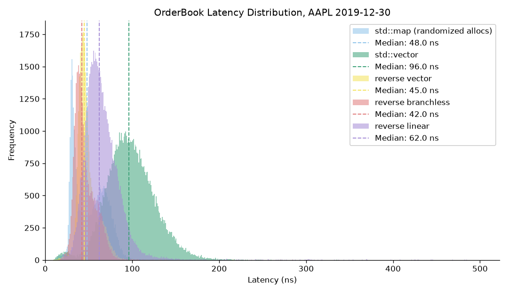
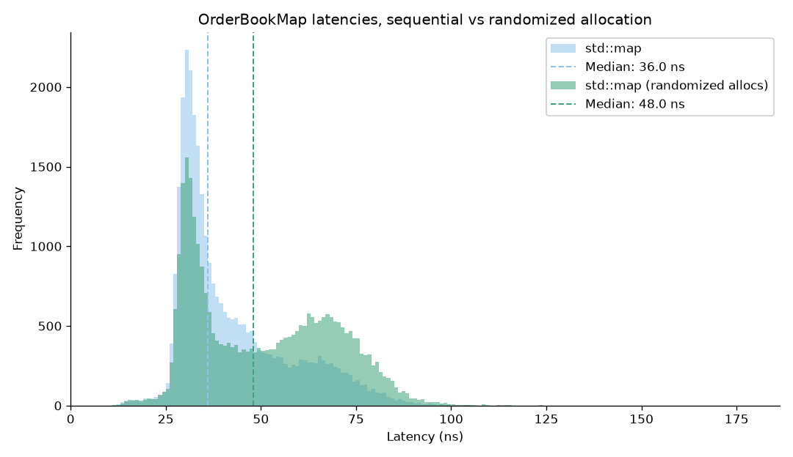
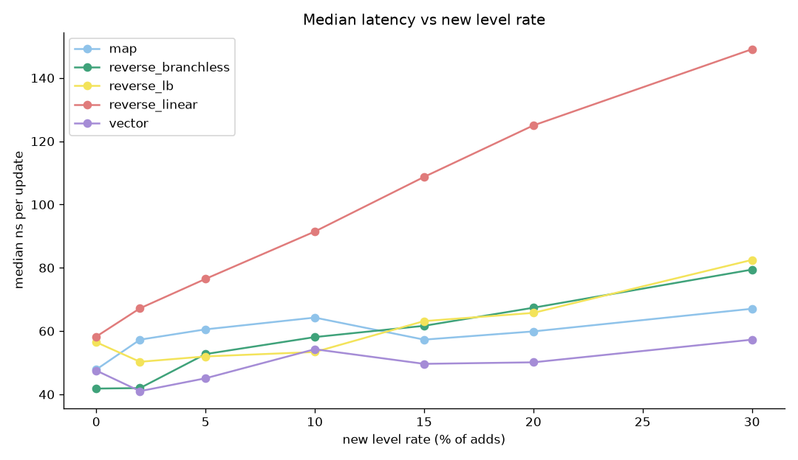

# Order Book Latency Benchmark

- Order book implementations, fed Nasdaq ITCH data and measured per update with the cycle counter.



## Overview

Follows David Gross, *When Nanoseconds Matter* (CppCon 2024).  Milestones 1 (harness) and 2 (three book designs) are done and measured.

- Feeds
  - `ob_genfeed` writes a synthetic feed with Zipf depth, tunable mix and new level rate
  - `ob_itch` converts a Nasdaq ITCH 5.0 day file into one feed per symbol
  - `ob_validate` replays a feed through the reference book and checks every invariant
- Books (`ob/`)
  - `ReferenceBook`: map of price to map of order, the correctness oracle
  - `MapBook`: `std::map` per side, level iterator stored per order
  - `VectorBook`: sorted vector per side, best price at the front
  - `ReverseVectorBook`: best price at the back, with `lower_bound`, branchless and linear search policies
  - `StubBook`: a counter, used to prove the harness can resolve a single increment
- Harness (`ob_bench`)
  - Cycle counter around blocks of updates, warmup excluded, allocation counting inside the timed region
  - Heap prefault and scramble, ASLR off, dithered histogram, five launch spread gate.
- Correctness
  - `ob_diff` replays every book against the reference in lockstep and stops at the first divergence
  - `ob_tests` covers every book, the ITCH framing, validate and diff
- Results, 1.6M updates, M4 Max (My Chip), clang 17 `-O2`

  | book | median ns | allocations per add |
  | --- | --- | --- |
  | ref | 81.8 | 2.20 |
  | map | 40.5 | 1.21 |
  | map, randomized heap | 46.1 | 1.21 |
  | forward vector | 106.1 | 0.99 |
  | reverse vector, lower_bound | 51.6 | 0.99 |
  | reverse vector, branchless | 50.8 | 0.99 |
  | reverse vector, linear | 72.9 | 0.99 |

  

  

- EXPLANATION:
  - Putting the best price at the back of the vector halves the forward vector's latency cost
  - Linear search is the worst on this data 

The pro-rata matching engine lives in `matching/` and still builds as `lob` and `lob_tests`.

## Build and run

```sh
cmake -S . -B build && cmake --build build
ctest --test-dir build

./scripts/fetch_itch.sh                                   # Nasdaq sample day into data/
./build/ob_itch --in data/12302019.NASDAQ_ITCH50.gz --symbols AAPL --out-dir results
./build/ob_bench --feed results/feed_itch_AAPL.bin --book reverse_branchless --hist results/hist.csv
./scripts/bench_all.sh                                    # the full matrix and the three charts
```

## TODO

custom open-addressing order table, zero allocations in the timed region.
level distribution instrument, measure the real search trip length, retune the synthetic generator from measured distributions.
Micro-optimizations from the talk, each with a before and after histogram.
Re-measure on GCC x86 Linux where branchless search is expected to beat `lower_bound`.
Bring every configuration inside the 5% spread gate.
Matching engine: FIFO price-time book, IOC / FOK / AON order types, order modification, strategies.
