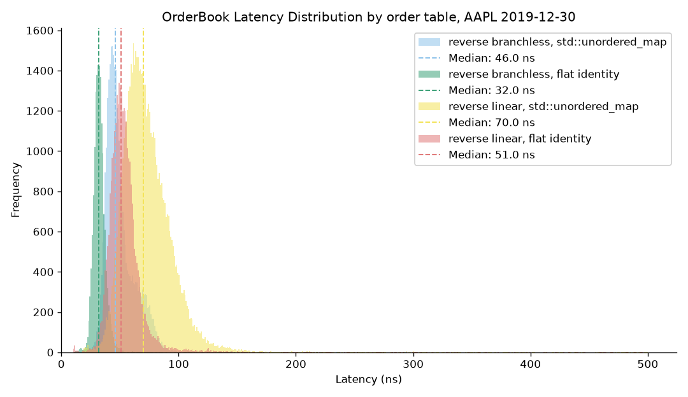
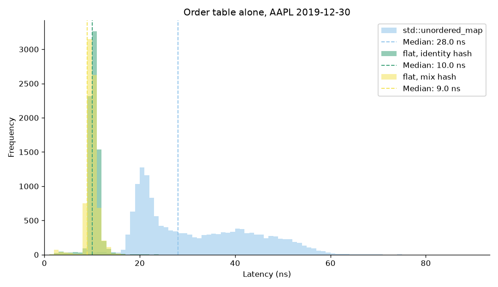

# Order Book Latency Benchmark

- Order book implementations, fed Nasdaq ITCH data and measured per update with the cycle counter.



## Overview

Heavily inspired by [David Gross CppCon talk](https://www.youtube.com/watch?v=sX2nF1fW7kI). Milestones 1 (the benchmark harness), 2 (three ways to store price levels) and 3 (the order id hash table) are done and measured.

- Feeds
  - `ob_genfeed` writes a synthetic and customizable feed for benchmarking
  - `ob_itch` converts a Nasdaq ITCH 5.0 day file into one feed per symbol
  - `ob_validate` checks that feed makes sense before it is used for benchmarking
- Books (`ob/`). Each one is a template on which order table it uses, so any level structure can be paired with any table
  - `ReferenceBook`: a slow but correct book used by ob_diff to check against our fast books
  - `MapBook`: `std::map` map<price, volume> for bids and asks and a
     hash table of orders. Each order holds an iterator to its price level, modifying or deleting O(1) on average
  - `VectorBook`: sorted vector of price levels with best price at front of vector, found with lower_bound. Inserting a new level near the top has to shift every level behind it
  - `ReverseVectorBook`: same as VectorBook but best price is located at the back, so inserting near the top only shifts a few levels. The search algo used for finding a price level is a template parameter (lower_bound, branchless, linear)
  - `TableOnlyBook`: just the order table, no price levels at all. Benchmarking it measures what the table alone costs on the real message mix
  - `StubBook`: a book that does nothing but increment a counter. Benchmarking it measures the benchmark's own overhead and noise.
- Order tables (`ob/OrderTable.hpp`), picked with `--table`. A modify or delete arrives with only an order id, so every book needs a table from id to the order's side, price and volume, and pays for it on two of the three message types
  - `std`: `std::unordered_map`, the baseline. Allocates a node for every add and chases a pointer on every lookup, so it is slow and we measure everything else against it
  - `identity` and `mix`: our own flat open-addressing table. One array of slots, power of two size so the modulo is a mask, linear probing so a collision only walks to the next slot in the same cache line, backward-shift deletion so deletes leave no tombstones behind. It is sized up front from the feed's peak live order count so it never grows during a run (growing would be a millisecond spike, so it is a hard error instead), and it makes zero allocations while running. `identity` uses the order id's low bits as the slot, which is free but breaks if ids collide on those bits. `mix` runs the id through one multiply-xor-shift round first, which costs a few cycles and works on any id pattern
- Benchmark (`ob_bench`)
  - times blocks of updates with the CPU cycle counter, drops first ~1% of samples, counts total heap allocation calls
  - Pre-grow heap to avoid page faults, optionally scramble which blocks you allocate, ASLR turned off (memory layout is the same every run), run five times, and if the difference between medians > 5% we flag the run as invalid
  - `--id-stride N` multiplies every order id by N before replay. With N equal to the table size every id lands on the same slot, the worst case for the identity hash
  - `--prefetch` prefetches the next update's table slot while the current one is being processed. Only possible because the whole feed is known in advance, so it is not a live feed technique
  - After each run it prints how full the table got and how far the average and the worst lookup had to walk from their home slot, so you can see the table behaving as designed rather than guess
- Correctness
  - `ob_diff` feeds the same data feed into the ReferenceBook and a fast book at the same time, compares the two after every message, and stops at a difference. Runs every book on every table
  - `ob_tests` unit tests for every book and table, the ITCH parser, the feed validator, and ob_diff. Includes one broken book to make sure the test works. Passes in Release, Debug and ASAN+UBSAN builds
- Results. Real AAPL order flow from 2019-12-30, 1.6M updates, on an Apple M4 Max with clang 17 at `-O2`. Every number is the median of five separate launches, in ns per update

  Milestone 2 compared the ways to store price levels, all using `std::unordered_map` for the order table:

  | book | median ns | allocations per add |
  | --- | --- | --- |
  | ref | 81.8 | 2.20 |
  | map | 40.5 | 1.21 |
  | map, randomized heap | 46.1 | 1.21 |
  | forward vector | 106.1 | 0.99 |
  | reverse vector, lower_bound | 51.6 | 0.99 |
  | reverse vector, branchless | 50.8 | 0.99 |
  | reverse vector, linear | 72.9 | 0.99 |

  Milestone 3 swapped the order table under the best books. These were measured on battery with the machine busy, so they are provisional until re-run on a quiet machine. The differences are many times bigger than the run to run noise, so the ranking stands:

  | book | std::unordered_map | flat, identity hash | flat, mix hash | allocations per add, std to flat |
  | --- | --- | --- | --- | --- |
  | table alone | 20.4 | 10.0 | 9.8 | 0.99 to 0 |
  | reverse vector, branchless | 45.9 | 31.7 | 32.1 | 0.99 to 0 |
  | reverse vector, linear | 66.7 | 52.4 | 52.6 | 0.99 to 0 |
  | map | 47.9 | 26.4 | 26.2 | 1.21 to 0.23 |

  

  

  

- What the numbers say
  - The order table was the real bottleneck, not the price levels. Swapping `std::unordered_map` for the flat table takes about 14 ns off every book and brings the vector books to zero allocations while running. That is a bigger win than any of the level structure changes in milestone 2
  - The identity hash is just as fast as the mix hash on a typical update but falls apart in the tail. On a synthetic feed with 1M live orders and sequential ids the ids wrap around the table and pile up, so the average lookup walks 102 slots and the slowest 1% take over 2 µs, while the mix hash walks 0.6 slots and stays at 50 ns. Multiply the ids by the table size and the identity hash takes 14 µs per lookup. The mix hash costs nothing measurable, so it is the one to use
  - Prefetching the next update's slot made no difference on this machine. The whole table fits in L2 cache, so the slot is already there
  - Putting the best price at the back of the vector halves the forward vector's cost, because real books are thousands of levels deep and new levels appear at the top. Linear search loses on this data because the level being touched is usually not within the first few


## Build and run

```sh
cmake -S . -B build && cmake --build build
ctest --test-dir build

./scripts/fetch_itch.sh                                   # Nasdaq sample day into data/
./build/ob_itch --in data/12302019.NASDAQ_ITCH50.gz --symbols AAPL --out-dir results
./build/ob_bench --feed results/feed_itch_AAPL.bin --book reverse_branchless --table mix --hist results/hist.csv
./build/ob_bench --feed results/feed_itch_AAPL.bin --book table --table identity --id-stride 65536   # the adversarial case
./build/ob_diff --feed results/feed_itch_AAPL.bin --book all --table all
./scripts/bench_all.sh                                    # the milestone 2 matrix and its charts
./scripts/bench_m3.sh && ./scripts/probe_sweep.sh         # the milestone 3 matrix, probe length against load, charts
```

## TODO

- Re-run the milestone 3 numbers on AC power with nothing else running
- Try a third-party flat hash map (absl, ankerl or boost) next to ours, as a second point of reference
- Measure where updates actually land in the book and how far the linear search really walks, then tune the synthetic feed generator to match the real distributions
- The small optimizations from the talk, each with a before and after histogram
- Re-measure on x86 Linux with GCC, where the branchless search is expected to beat `lower_bound`
- Get every configuration inside the 5% spread gate
